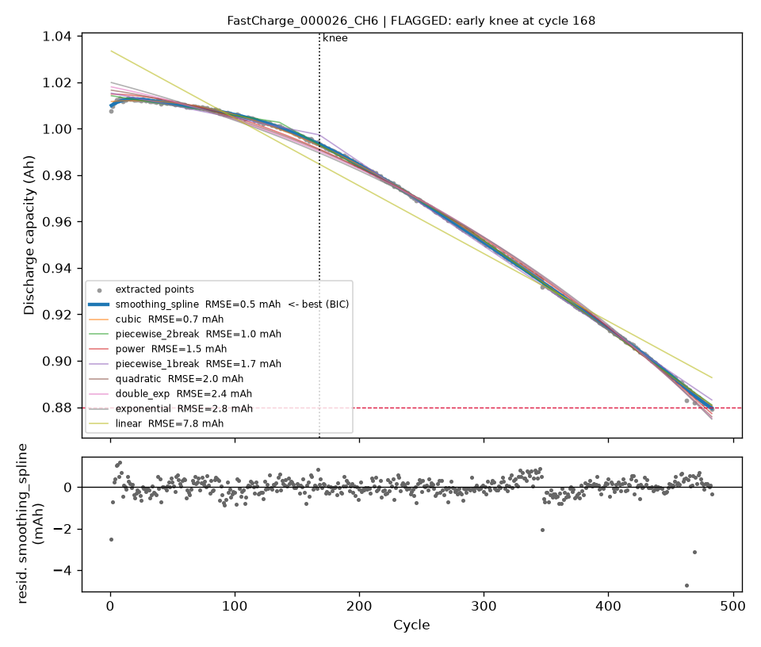
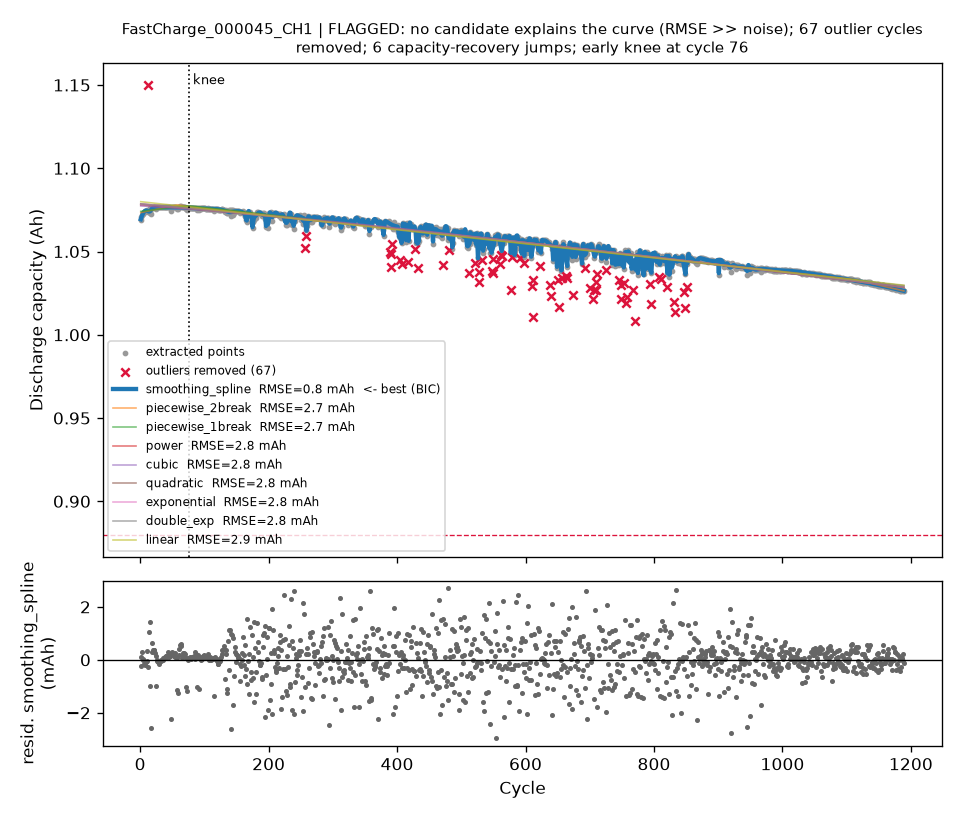
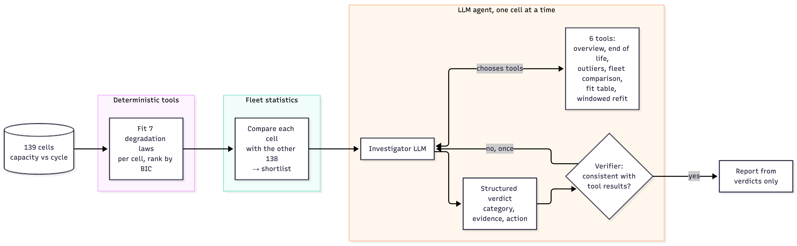
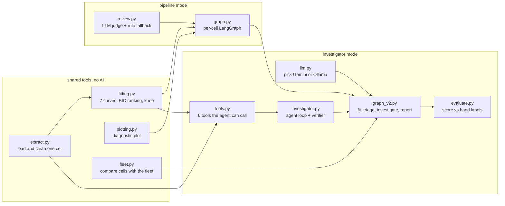
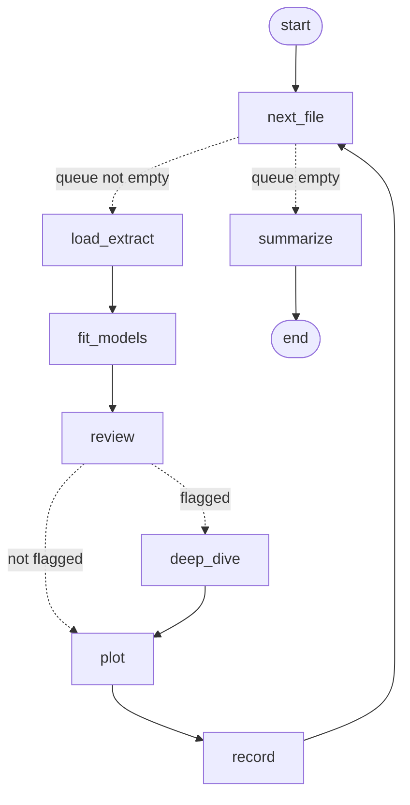
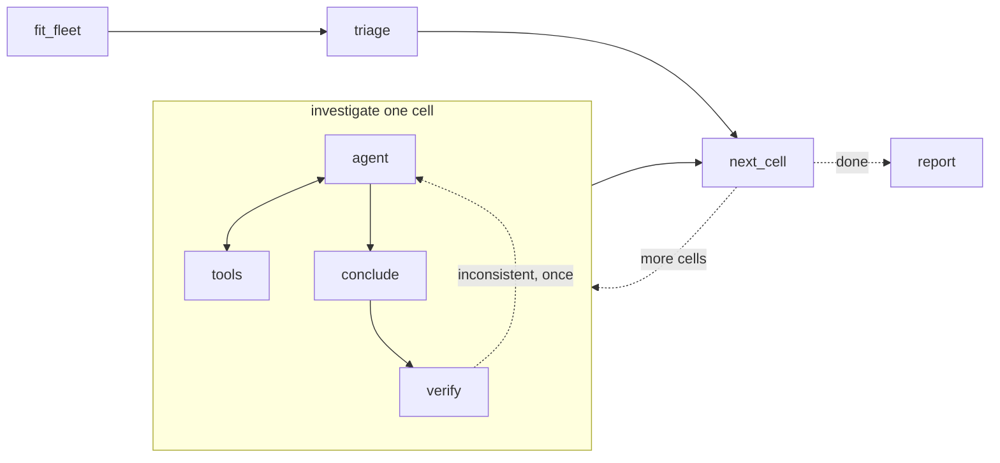
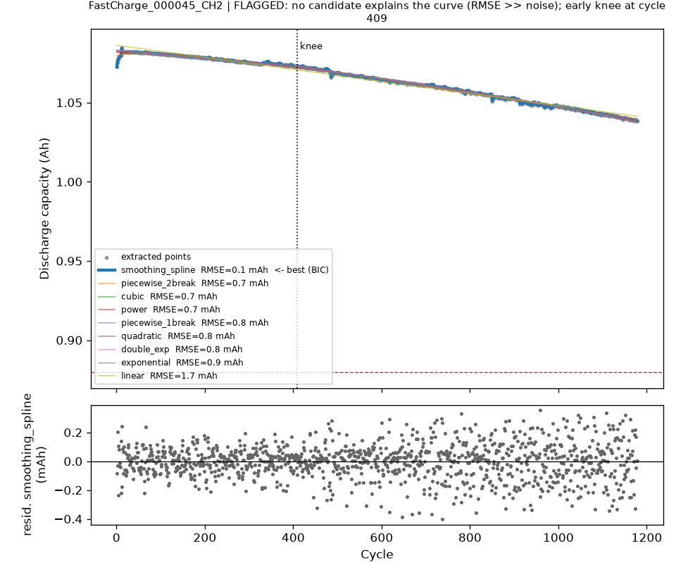
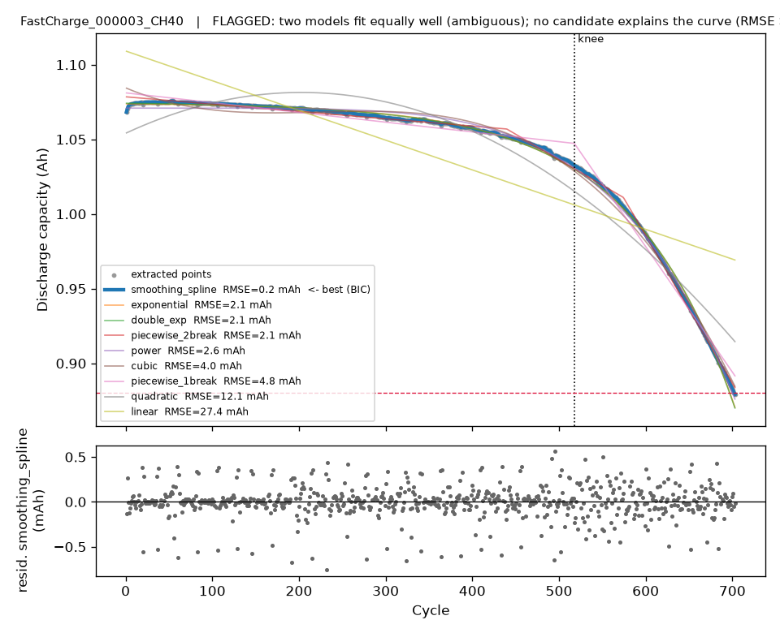

# battery-fit-agent

**An AI agent that reads battery ageing data, works out how each cell is wearing out, and tells an engineer which
cells deserve a closer look and why.**

## In plain words

Every rechargeable battery loses capacity as it is charged and discharged. Plot capacity against cycle number and
you get a *degradation curve*: usually a slow, almost straight decline, then a "knee" after which capacity drops
quickly until the cell reaches *end of life* (by convention 80 % of its original capacity).

Battery labs test hundreds of cells at a time. An engineer then fits mathematical curves to each one, decides which
curve describes it best, and looks for the odd ones out i.e. cells that age too early, curves no formula explains, or
data spoiled by a faulty instrument. That is slow, repetitive work, and this project automates it.

It does so in three layers, each doing what it is best at:

| Layer | Job | Technology |
|---|---|---|
| **Tools** | clean the data, fit seven candidate curves, measure fit quality, find the knee | Python (NumPy, SciPy), no AI |
| **Fleet statistics** | decide which cells are unusual *compared with the other 138* | robust statistics, no AI |
| **LLM agent** | investigate each unusual cell with the tools, decide what kind of problem it is, explain it in words | any of five providers (Groq, Gemini, Claude, OpenRouter, local Ollama), orchestrated with LangGraph |

The AI never invents a number. It decides which questions to ask, calls tools that compute the answers, and
reasons over the results. A separate check makes sure its conclusions agree with those results.

The data is the public fast-charging dataset of 139 lithium-iron-phosphate cells from
Severson et al., *Data-driven prediction of battery cycle life before capacity degradation*, Nature Energy (2019).
The per-cell data ships with the repository, so everything runs straight after cloning.

<p align="center">
  
  
</p>
<p align="center"><sub>Left: a cell that ages early (knee at cycle 168, end of life at 483). Right: a cell whose data
is spoiled by 67 outlier measurements (red crosses). Each plot shows the data, the fitted curves, the knee, the
end-of-life line and, below, what the best curve fails to explain.</sub></p>

## Architecture

<p align="center"></p>

### Two modes, one set of building blocks

The project grew in two steps, and both are kept because the comparison between them is the main finding.

| | **Pipeline mode** (first version) | **Investigator mode** (second version) |
|---|---|---|
| Entry point | `run_agent.py`, [walkthrough notebook](notebooks/battery_fit_agent_walkthrough.ipynb) | `run_investigator.py`, [Colab notebook](notebooks/colab_investigator.ipynb) |
| Who decides what happens next | every cell goes through the same fixed steps | the code for the overall flow; the **LLM** for how each shortlisted cell is investigated |
| What the LLM does | judges every cell: "flag it or not?" | investigates only the shortlist, choosing which tools to call and when it knows enough |
| How cells are shortlisted | per-cell thresholds, then a fleet comparison afterwards | fleet comparison built into the graph |
| Model | Llama 3.1 8B, local (Ollama) | any provider; results below with GPT OSS 120B on Groq |
| Outcome | the LLM flagged 139 of 139 cells and its report missed the real shortlist | 9 of 10 verdicts match the hand labels, the verifier corrected 3 |

In the usual terminology, pipeline mode is a **workflow** (an LLM fills one slot in a fixed sequence) and
investigator mode adds an **agent** (an LLM that chooses its own actions in a loop) inside that workflow.

Both modes are built with [LangGraph](https://github.com/langchain-ai/langgraph). A LangGraph program is a graph of
plain Python functions (*nodes*). A shared dictionary (the *state*) is passed from node to node, each node reads
it and returns the fields it changed. *Edges* say which node runs next, and *conditional edges* choose the next node
from the state (for example "more cells left?" or "did the model ask for a tool?").

### Building blocks

All code is in the `battery_fit_agent/` package. The modules on the left are shared while the rest belong to one mode.



| Module | What it does |
|---|---|
| `extract.py` | Reads one cell's CSV, removes impossible values and outliers (points far from a rolling median), estimates measurement noise, counts sudden capacity recoveries after rest periods, finds the end-of-life cycle. |
| `fitting.py` | Fits seven candidate curves (linear, quadratic, cubic, power, exponential, double exponential, 1-break piecewise joined at the knee), ranks them using the Bayesian information content (BIC), and computes the evidence used for flagging (fit error vs. noise, gap to the runner-up, knee position). |
| `plotting.py` | Draws the per-cell diagnostic plot. |
| `fleet.py` | Compares every cell with the rest of the fleet using robust z-scores (how many "typical deviations" a cell is from the median) and builds the shortlist with reasons. |
| `review.py` | Pipeline mode's LLM judge, with rule-based fallback when no model is available. |
| `graph.py` | Pipeline mode's LangGraph: one pass of fixed steps per cell. Investigator mode reuses it, without the LLM, to fit the fleet. |
| `llm.py` | Creates the chat model for the chosen provider (Groq, Gemini, Claude or local Ollama) and adds a rate limiter for free API tiers. |
| `tools.py` | The six tools the investigator can call (below). They read the fitted results and raw data. They are the agent's only source of numbers. |
| `investigator.py` | The investigator agent (a loop between the model and the tools), the structured verdict format, the verifier, a rule-based baseline classifier, and the trace writer. |
| `graph_v2.py` | Investigator mode's outer LangGraph: fit the fleet, triage, investigate each shortlisted cell, write the report. |
| `evaluate.py` | Scores the agent's verdicts, and the baseline's, against hand labels. |

### Pipeline mode



| Node | What it does |
|---|---|
| `load_extract` | Loads and cleans the next cell (`extract.py`). |
| `fit_models` | Fits and ranks the seven curves (`fitting.py`). |
| `review` | Runs fixed rule checks, then asks the LLM for a JSON decision `{flag, priority, reasons, comment}`; an unusable reply, or `--no-llm`, falls back to the rules. |
| `deep_dive` | Flagged cells only: adds two very flexible curves to test whether the misfit is smooth structure or noise. |
| `plot` / `record` | Saves the plot, the fit table and a summary row. |
| `summarize` | Flags cells whose knee is unusually early versus the fleet, writes `summary.csv`, and has the LLM write a report. |

`fleet.py` then re-scores every cell against the fleet after the run (see Results).

### Investigator mode

**Outer workflow** (`graph_v2.py`, fixed order):



1. **`fit_fleet`** runs pipeline mode's graph without the LLM over all cells: clean, fit, plot.
2. **`triage`** compares each cell with the fleet and builds the shortlist. Compared with the first version it
   ignores near-ties when calling a curve shape "different" (the fleet's curve must lose by ΔBIC ≥ 10), and it
   leaves out of the knee comparison any test that stopped before 70 % of the way to end of life, because their
   knee is measured against an unfinished test.
3. **`investigate`** runs the investigator agent on each high-priority cell (or every flagged cell, or a given list).
4. **`report`** gives the model the structured verdicts only (not 139 raw cells) and asks for a short report.

**The investigator agent** (`investigator.py`, one cell at a time) is where the model is in charge:

| Step | What happens |
|---|---|
| `start` | The model gets its role, the five possible categories, guidance on which tool answers which question, and the cell's diagnostic plot as an image. |
| `agent` ⇄ `tools` | The model either asks for one or more tool calls or says it is done. Requested tools run, their JSON results go back to the model, and it decides again. At most six rounds. |
| `conclude` | The model returns a **structured verdict**: a category, a confidence, 2–4 pieces of evidence quoting tool numbers, and a recommended next step. |
| `verify` | Plain Python compares the verdict with the tool results. If they contradict each other, the agent is sent back once with the specific problem. |

The five categories:

| Category | Meaning |
|---|---|
| `real_early_ageing` | reached end of life, and its fast fade started unusually early compared with the fleet |
| `unusual_shape` | ages along a different curve than the fleet, or two curves fit equally well, without data problems |
| `test_ended_before_eol` | the test stopped far from end of life, so life-based comparisons do not apply |
| `data_quality` | outliers or jumps that point to a measurement or equipment problem dominate |
| `normal` | nothing unusual on closer inspection |

**The tools** (`tools.py`). Each is a Python function with a description the model reads to decide when to use it:

| Tool | Question it answers | Returns |
|---|---|---|
| `get_cell_overview` | What do we know about this cell? | cycles, end of life, start and end capacity, noise, knee, outliers, best curve and runner-up, fleet z-scores, why it was shortlisted |
| `check_end_of_life` | Did the test finish, or did it stop early? | whether 80 % capacity was reached, share of the fade completed, recent fade rate, cycles still to go at that rate |
| `locate_outliers` | Is this bad data? | where the removed points sit (by quarter of the test), whether they are one-sided dips, how large, recovery jumps |
| `compare_to_fleet` | Is this value unusual? | one of seven metrics against the fleet median, quartiles and this cell's percentile |
| `get_fit_table` | Which curves fit, and how decisively? | all seven curves on the whole test, ranked by BIC |
| `refit_window` | Does the picture change on part of the test? | all curves refitted on a chosen range of cycles (before or after the knee, or excluding a suspect stretch) |

**The verifier's checks:**

- the model must have called `get_cell_overview`,
- `real_early_ageing` or `test_ended_before_eol` require `check_end_of_life`, and must agree with its answer,
- `data_quality` needs at least 3 outliers or 3 capacity-recovery jumps.

**An example run**, from the synthetic test data (cell `SYNTH_010`, a test stopped at 35 % of its life). The model
first gave a deliberately wrong verdict to exercise the verifier:

```
call get_cell_overview(SYNTH_010)        -> 358 cycles, never reached end of life, knee at 19 % of "life"
call check_end_of_life(SYNTH_010)        -> fade completed: 5 %, about 6000 cycles still to go
call locate_outliers(SYNTH_010)          -> 0 outliers
call compare_to_fleet(knee_fraction)     -> 0.19 vs fleet median 0.80
verdict: real_early_ageing
verifier: "check_end_of_life says the cell never reached end of life (fade completed 5 %)"
verdict: test_ended_before_eol
```

Every real run writes one of these traces per cell to `traces/<cell>.md`.

**Evaluation.** `results/manual_labels.csv` holds hand labels for the ten high-priority cells of the first run.
The agent's verdicts are scored against them, alongside a rule-based baseline: a fixed decision list over the same
facts the agent can query. The agent should at least match the baseline; its added value is handling the
ambiguous cases and explaining each decision in a form an engineer can check.

### Glossary

| Term | Meaning here |
|---|---|
| Capacity, Ah | how much charge the cell delivers in one discharge; these cells start near 1.07 Ah |
| End of life (EOL) | capacity below 0.88 Ah (80 % of the 1.1 Ah rating) |
| Knee | the point where slow, steady fade turns into fast fade |
| RMSE, noise | the typical error of a fitted curve, and the typical cycle-to-cycle scatter of the measurement itself (both in mAh) |
| BIC, ΔBIC | a score that rewards fitting the data well and penalises extra parameters; lower is better. A gap above about 10 is decisive, below 2 is a tie |
| Robust z-score | how far a cell is from the fleet median, in units of the fleet's typical spread (median absolute deviation) |
| LLM | large language model (here GPT OSS, Claude, Gemini or Llama) |
| Tool | a Python function the model can ask to run; the model sees its description and its result, never its code |
| Structured output | the model's answer is forced into a fixed schema (category, confidence, evidence, action) instead of free text |

## Results on 139 Severson cells (pipeline mode)

**Which law explains the data?** Setting the flexible deep-dive models aside, the **double exponential** is the best
parametric law (by BIC) for **115 of 139** cells i.e. a slow, almost linear early fade followed by an accelerating knee.
The rest split between exponential (8), cubic (6), power (6) and 1-break piecewise linear (4).

**Which cells should a human look at?** The original (per-cell) criteria flag **139 of 139** cells (138 with the LLM's
"high" priority), which is no triage at all. The main trigger is best-fit RMSE much larger than the cell's own
cycle-to-cycle noise. That is true for almost every long, low-noise curve, because no 3–4 parameter law tracks
~1000 cycles at a 0.1 mAh noise floor. The deep-dive spline brings RMSE/noise down to about 1.1–1.3 in all but a
couple of cells, which shows the residual is smooth structure, not noise.

Re-scoring each cell against the fleet (robust z-scores of misfit and knee position, agreement with the fleet's
majority law, data-quality counts) cuts the list to **32 of 139** (fleet law: double exponential), of which **10 are high priority**. Reading the
plots of those 10 sorts them into three kinds:

| Kind | Cells | What the plots show |
|---|---|---|
| **Real early ageing** | 000026_CH5, 000041_CH10, 000026_CH6, 000008_CH47 | Short-lived cells (end of life at cycles 148–616) whose knee comes early and whose fade is better described by a cubic than by the fleet's double exponential. |
| **Unusual shape or tied models** | 000003_CH40, 000068_CH38, 000062_CH47 | Exponential or power law beats the double exponential, or the two are statistically tied (ΔBIC = 0.3), two also have a few outlier cycles. |
| **Never reached end of life** | 000045_CH2, 000045_CH3 | Almost linear fade to ~1.04 Ah over ~1180 cycles. With no end-of-life cycle, knee position is measured against test length, so the "early knee" is an artefact. |
| **Data quality** | 000045_CH1 | 67 outlier cycles and 6 capacity-recovery jumps, concentrated between cycles 400 and 850: a measurement or test equipment problem rather than ageing. |

<p align="center">
  
  
</p>

The full shortlist with reasons is in [`results/summary_fleet.csv`](results/summary_fleet.csv).

## What I learned about the LLM's role

These findings are what led to investigator mode.

Running the same agent on 19 cells and then on 139 made the LLM's limits easy to see.

- **It did not triage.** The per-cell reviewer flagged all 139 cells and gave 138 of them "high" priority, so its
  decisions added nothing to the rule checks it was shown.
- **Its reasons contradict the evidence it was given.** In 16 cells it called the best model "ambiguous"; in 11 of
  those the runner-up was more than 10 BIC units behind (one by 1182), which is decisive. The numbers it receives
  are computed deterministically, which is why the rule-based reasons are always stored next to the LLM's.
- **Its report missed the shortlist entirely.** The fleet report ([`results/report_llm.md`](results/report_llm.md))
  recommends three cells to inspect first, none is among the 32 the fleet review flags, and all three come from
  the last 15 cells of the input list. The most likely cause is that the prompt listing 139 flagged cells is longer
  than the model's context window, so the start of the list is cut off. It also repeats the claim that the
  smoothing spline is "the best model", which is an artefact of the deep dive, not a physical finding.

The useful division of labour turned out to be: deterministic tools for every number and every flag, statistics
across the fleet for the triage, and the LLM only for wording, fed the short list rather than every cell.

## Results: investigator mode

Run on the ten hand-labelled cells with **GPT OSS 120B on Groq's free tier** (full record:
[`results/verdicts_investigator_groq.csv`](results/verdicts_investigator_groq.csv),
[`results/report_investigator_groq.md`](results/report_investigator_groq.md)). With the stricter triage, 31 of the
139 cells are flagged and 7 are high priority.

| | Pipeline mode (Llama 3.1 8B) | Investigator mode (GPT OSS 120B) |
|---|---|---|
| Cells flagged | 139 of 139 | 31 of 139 by the fleet triage |
| Verdicts matching the hand labels | not measurable (no categories) | **9 of 10** |
| Tool calls per cell | none | 2–4, chosen by the model |
| Verdicts corrected by the verifier | no verifier | 3 of 10, all to the right category |
| Report | missed every shortlisted cell | groups all ten correctly and quotes only tool numbers |

| Cell | Hand label | Agent | Notes |
|---|---|---|---|
| 000003_CH40 | unusual shape | unusual shape | exponential and double exponential tied (ΔBIC 0.3) |
| 000008_CH47 | real early ageing | real early ageing | revised after the verifier |
| 000026_CH5 | real early ageing | real early ageing | revised after the verifier; end of life at cycle 209, knee at 13 % of life |
| 000026_CH6 | real early ageing | real early ageing | revised after the verifier |
| 000041_CH10 | real early ageing | real early ageing | shortest-lived cell (end of life at cycle 148) |
| 000045_CH1 | data quality | test ended before end of life | both apply: 67 outliers, and only 24 % of the fade completed; accepted |
| 000045_CH2 | test ended before end of life | test ended before end of life | |
| 000045_CH3 | test ended before end of life | test ended before end of life | stopped at cycle 1,176 with about 3,500 more cycles to go at its recent fade rate |
| 000062_CH47 | unusual shape | **data quality** | 4 outliers at cycles 447–450, after end of life at 429, about 28 mAh below trend |
| 000068_CH38 | unusual shape | unusual shape | power law beats the fleet's double exponential (ΔBIC 64.6) |

**Reading these numbers honestly.**

- The one disagreement is a judgement call rather than an error: the agent noticed that the outliers sit after end of
  life, at the very end of the test, which the hand label had not considered.
- The rule-based baseline scores 10 of 10, but the hand labels and those rules were written from the same reading
  of the plots, so that comparison favours the rules. The agent's added value is different: each verdict comes with
  evidence an engineer can check, and it can handle cases no rule anticipated, such as outliers after end of life.
- The verifier matters. Three first verdicts contradicted the tool results (for example "early ageing" without
  checking end of life) and were corrected after one round of feedback.
- Ten labelled cells is a small test set, labelled by one person. It shows the design works; it is not a benchmark.

An earlier partial run with Gemini on its free tier stopped after three cells because of the daily request quota
(20 requests per model per day). Of those three, it agreed on two and called 000026_CH5 "normal" before the run was
cut short. That run is why the code now retries on overload, stops cleanly on an exhausted daily quota, and supports
several providers.

## Quick start

```bash
git clone https://github.com/ThomasAko/battery-fit-agent.git
cd battery-fit-agent
python -m venv .venv && source .venv/bin/activate
pip install -r requirements.txt

# Runs on the bundled per-cell CSVs (data/battery_data_store); no download needed
python run_agent.py --no-llm             # rule-based reviewer, a few minutes for all 139 cells
python run_agent.py --no-llm --limit 20  # quick look at 20 cells
```

With the LLM reviewer:

```bash
ollama pull llama3.1:8b      # ~5 GB, runs on a laptop
ollama serve                 # if it is not already running
python run_agent.py          # reads data/battery_data_store, writes agent_outputs
```

Investigator mode with Gemini (free key from [Google AI Studio](https://aistudio.google.com/apikey)), or open the
[Colab notebook](notebooks/colab_investigator.ipynb):

```bash
export GOOGLE_API_KEY=...
python run_investigator.py                          # high-priority shortlist
python run_investigator.py --investigate labelled   # the 10 hand-labelled cells, scored against the labels
python run_investigator.py --skip-fit               # reuse the fits from a previous run
```

Options for the original pipeline: `--data`, `--out`, `--model`, `--ollama-url`, `--no-llm`, `--limit N`
(or the environment variables `BFA_DATA_STORE`, `BFA_OUT_DIR`, `BFA_MODEL`, `OLLAMA_URL`).
If Ollama is not reachable, every review falls back to the rules and the run still completes.

`scripts/make_synthetic_cells.py` generates a small synthetic fleet with planted anomalies
(early knee, logger glitches, rest-recovery jumps), useful for checking that the triage catches them.

## Data

Per-cycle summaries for every cell are included in `data/battery_data_store/` (one ~100 kB CSV per cell),
extracted from the BEEP-structured Severson files at [data.matr.io/1](https://data.matr.io/1/).
The raw JSONs (100-200 MB each) are not included; `scripts/extract_cycle_csvs.py` rebuilds the CSVs from them.
See [data/README.md](data/README.md).

The agent works on any folder of CSVs with a cycle column and a discharge-capacity column
(`QD` is accepted as an alias), so other datasets need only a small conversion step:

```
cycle_index,discharge_capacity
1,1.0712
2,1.0718
```

## Notebooks

| Notebook | What it is |
|---|---|
| [`battery_fit_agent_walkthrough.ipynb`](notebooks/battery_fit_agent_walkthrough.ipynb) | Pipeline mode written out inline, cell by cell, with the outputs of the full 139-cell run with Llama 3.1 8B. A record of the first version and the evidence for the findings above. Runs locally with Ollama. |
| [`colab_investigator.ipynb`](notebooks/colab_investigator.ipynb) | Investigator mode, ready to run in Google Colab with a free Gemini key: clones this repo, runs fit, triage, investigation and report, then shows the verdicts, the score against the hand labels, a trace and the plots. It imports the package rather than repeating the code. |

Swapping a stronger model into the walkthrough would not fix what it showed: the problem was the LLM's role (judging
every cell against fixed thresholds, from a prompt too long to read), not only the model's size.

## Outputs

| File | Contents |
|---|---|
| `agent_outputs/plots/<cell>.png` | diagnostic plot per cell |
| `agent_outputs/<cell>_fits.csv` | every model's RMSE, R², AIC, BIC, ΔBIC |
| `agent_outputs/summary.csv` | one row per cell: best model, knee, flags, reasons, deep-dive note |
| `agent_outputs/summary_fleet.csv` | fleet-relative re-scoring and shortlist |
| `agent_outputs/report.md` | LLM-written report (or a rule-based summary) |

Investigator mode writes to `agent_outputs_investigator/` the same per-cell files plus:

| File | Contents |
|---|---|
| `summary_triage.csv` | fleet triage with the stricter criteria, incl. how far each test got towards end of life |
| `verdicts.csv` | one row per investigated cell: category, confidence, evidence, action, tool calls, whether the verifier sent it back, baseline category |
| `traces/<cell>.md` | step-by-step record of each investigation |
| `report_investigator.md` | report written from the verdicts |
| `evaluation.csv` | verdicts vs. hand labels (labelled cells only) |

## Repository layout

```
battery_fit_agent/      package: extract, fitting, plotting, review, graph, fleet (original pipeline);
                        llm, tools, investigator, graph_v2, evaluate (investigator mode)
run_agent.py            original pipeline
run_investigator.py     investigator mode
data/                   per-cell CSVs extracted from the Severson dataset (raw JSONs not included)
scripts/                dataset conversion and synthetic demo data
notebooks/              walkthrough of the 139-cell run with the LLM reviewer; Colab notebook for investigator mode
results/                snapshot of that run (fleet shortlist, LLM report) and the hand labels
tests/                  unit tests, incl. the investigator with a scripted stand-in model (pip install -r requirements-dev.txt)
docs/figures/           figures used in this README
```

## Known limitations

- The fleet level early-knee check runs after the per-cell plots are drawn, so a cell flagged only by that check
  says "not flagged" in its plot title; `summary.csv` is authoritative.
- In the original pipeline, cells that never reach 80 % capacity get a knee position relative to test length,
  which can look like an early knee (batch 000045); investigator mode excludes them from the knee comparison.
- Hand labels cover only the ten high-priority cells of the first run and were made by one person from the plots.
- Candidate laws are empirical; there is no physics-based ageing model (SEI growth, lithium plating) in the set yet.
- Thresholds (fit-to-noise 2.5, ΔBIC 2, robust z ±2.5/3) were set on this dataset and should be revisited for other chemistries.
- In the original pipeline, "shape differs from the fleet" fires even when the fleet law loses by only a few BIC
  units; investigator mode requires ΔBIC ≥ 10.

## Next steps

- Run the investigator over all 31 flagged cells and compare providers (Groq, Gemini, Claude, local) on the same labels.
- Grow the labelled set beyond ten cells, ideally with a second labeller.
- Raise the report model's context window (`num_ctx`) in the original pipeline, or retire its per-cell LLM review
  in favour of the investigator.
- Add physics-based ageing laws (SEI growth, lithium plating onset) to the candidate set and as investigator tools.
- Let the investigator request a deeper look at neighbouring cells from the same batch.


## License

MIT, see [LICENSE](LICENSE).
